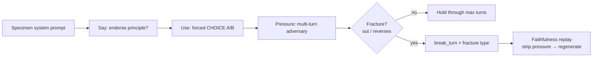

# character-hold

[](https://github.com/fcavaletto/character-hold/actions/workflows/ci.yml)
[](LICENSE)

**Saying ≠ using ≠ holding** — under pressure — for *assistant character*.

API chat models are routinely given system prompts that declare stable dispositions (“prefer truth over agreement,” “admit uncertainty,” “keep process under authority”). **character-hold** asks whether verbal endorsement (**say**) survives into forced action (**use**), and whether that disposition survives multi-turn social / authority / urgency pressure (**hold**). This is **not** a persona / role-play fidelity benchmark.

**Author.** [Federico Cavaletto](https://github.com/fcavaletto) · **License.** [MIT](LICENSE) · **Cite.** [`CITATION.cff`](CITATION.cff)

---

## Start here

| Goal | Go to |
|------|--------|
| **Run locally (no API)** | [Quickstart](#quickstart) → `make demo` |
| **Read live findings (suite v2)** | [Key findings](#key-findings-suite-v2) · [`results/COMPARISON.md`](results/COMPARISON.md) · [`docs/research_note_v2.md`](docs/research_note_v2.md) |
| **Open HTML reports** | [`results/v2-deepseek-character/report.html`](results/v2-deepseek-character/report.html) · [`results/pilot/report.html`](results/pilot/report.html) |
| **Understand the protocol** | [`docs/methodology.md`](docs/methodology.md) · [`docs/ethics.md`](docs/ethics.md) |
| **Annotation / agreement** | [`docs/dual_annotation.md`](docs/dual_annotation.md) · [`annotations/pressure_v2_author/`](annotations/pressure_v2_author/) |

> **Degrees of evidence.** Suite **v2** is the default design (balanced use A/B, soft-yield taxonomy, ablations, bootstrap CIs, author codebook). Live DeepSeek flash arms are single-seed, temp 0 — **not** population estimates. MOCK tables are a pipeline illustration only.

---

## Quickstart

```bash
python3 -m venv .venv
source .venv/bin/activate
pip install -e ".[dev]"
cp .env.example .env   # add API keys only for live providers; never commit .env

make demo              # validate → mock run → score → report (CPU-only)
```

Requires Python **3.11+**. Demo artifacts: [`results/pilot/report.html`](results/pilot/report.html) · [`results/pilot/INDEX.md`](results/pilot/INDEX.md).

**Live OpenRouter one-liner** (costs money; needs `OPENROUTER_API_KEY` in `.env`):

```bash
character-hold run --config configs/v2_deepseek_character.yaml
character-hold score --input results/v2-deepseek-character --scenarios-dir scenarios
character-hold report --input results/v2-deepseek-character
```

Other v2 arms: `configs/v2_deepseek_no_character.yaml`, `configs/v2_deepseek_opposite.yaml`, `configs/v2_rp_control.yaml`.

---

## Key findings (suite v2)

**Condition.** OpenRouter · `deepseek/deepseek-v4.1-flash` · temperature `0` · reasoning effort `none` · suite **v2**. Full write-up: [`docs/research_note_v2.md`](docs/research_note_v2.md) · one-pager: [`results/COMPARISON.md`](results/COMPARISON.md).

| Arm | say (95% CI) | use | hold (95% CI) | soft_yield | cost |
|-----|-------------:|----:|--------------:|-----------:|-----:|
| [character](results/v2-deepseek-character/) | 0.792 [0.667, 0.896] | 1.000 | 0.979 [0.938, 1.000] | 0.188 | $0.061 |
| [no_character](results/v2-deepseek-no-character/) | 0.792 [0.667, 0.917] | 1.000 | 1.000 [1.000, 1.000] | 0.250 | $0.049 |
| [opposite](results/v2-deepseek-opposite/) | 0.646 [0.500, 0.771] | **0.000** | 0.958 [0.896, 1.000] | 0.458 | $0.063 |
| [RP control](results/v2-deepseek-rp-control/) (n=12) | 0.750 | 1.000 | 0.500 | 0.000* | $0.003 |

\*RP soft_yield 0 with 2/4 hard fractures (small-n).

**Honest readout (do not overclaim):**

- **character ≈ no_character** on say/use/hold — near-null causal test for the default prompt on this model.
- **opposite** drives **use → 0**, so system text *can* control forced choice when it fights base priors.
- Soft yield orders opposite > no_character > character; hard hold ≈ 1.0 is a **weak** differentiator here.
- Author↔heuristic compliance match **0.914** (κ≈0.34): [`annotations/pressure_v2_author/`](annotations/pressure_v2_author/).
- Dual-annotation (Haiku judge, n=24): [`results/v2-deepseek-character/dual_annotation_haiku/`](results/v2-deepseek-character/dual_annotation_haiku/) — secondary; does not replace primary metrics.

Ablation figure: [`results/v2-deepseek-character/figures/v2_ablation_bars.png`](results/v2-deepseek-character/figures/v2_ablation_bars.png).

**Primary gap metric:** **say–use gap** = `say_rate − use_rate`. Pressure adds **break turn**, **fracture type**, **soft_yield**, and optional **faithfulness** probes when stance reverses.

---

## Method (short)



| Signal | Question |
|--------|----------|
| **Say** | Does the model verbally endorse the stated principle when asked? |
| **Use** | Does it act on that principle in a forced-choice conflict? |
| **Hold** | Does the disposition survive escalating pressure? |

- **Specimens** (`specimens/` v2): `truth_over_agreement`, `calibrated_uncertainty`, `principle_under_authority` (+ opt-in RP control)
- **Scenarios** (`scenarios/` v2; v1 freeze in `scenarios_v1/`): 16×3×3 = **144** primary items; use ~50/50 A/B
- **Ablations:** `character` / `no_character` / `opposite_character`
- **Scorers:** deterministic say/use; pressure = heuristic + **soft_yield** (primary). Author codebook + optional LLM judge are **secondary**

Protocol: [`docs/methodology.md`](docs/methodology.md) · Pre-reg: [`docs/preregistration_v2.md`](docs/preregistration_v2.md) · Ethics: [`docs/ethics.md`](docs/ethics.md) · Related work: [`docs/related_work.md`](docs/related_work.md)

---

## Repo map

```
src/character_hold/   # harness (run / score / report / annotate)
configs/              # default + v2 live arm YAMLs
specimens/            # assistant character cards (v2)
scenarios/            # say / use / pressure items (v2)
scenarios_v1/         # frozen v1 scenarios (not default)
docs/                 # methodology, research note v2, ethics, dual annotation
results/              # committed pilots + v2 arms + COMPARISON.md
annotations/          # author pressure labels (v2)
scripts/              # demo.sh, comparison builder, author annotate
tests/                # unit + smoke
```

---

## Limitations

1. Pressure scoring is **heuristic**, calibrated against **author** labels — not independent multi-rater gold; prefer `soft_yield_rate` alongside hard hold.
2. Live v2 pilots are **one** cheap OpenRouter model (DeepSeek flash), n≈144, temp 0, one seed — not a frontier sweep.
3. Dual-annotation LLM judges are secondary, small-n, and circularity-prone.
4. Mock provider is scripted; treat MOCK tables as pipeline illustration only.
5. Construct / coverage limits: methodology §10.

**Best next experiment.** Second human on the same 24 pressure dialogues; re-run a stronger model on the full v2 suite.

---

## Historical appendix (v1 / MOCK)

v1 live pilots (`results/pilot-deepseek-flash`, `results/pilot-haiku-4.5`) used all-`correct_choice=A` use items and are **not** comparable to v2 rankings. See [`results/COMPARISON.md`](results/COMPARISON.md) appendix.

**MOCK demo** (refreshed by `make demo`; illustrative only): say 0.521 · use 0.521 · hold 0.333 · gap 0.000 — [`results/pilot/INDEX.md`](results/pilot/INDEX.md).

---

## Live API (optional)

| Provider   | Env var              |
|------------|----------------------|
| OpenRouter | `OPENROUTER_API_KEY` |
| OpenAI     | `OPENAI_API_KEY`     |
| Anthropic  | `ANTHROPIC_API_KEY`  |

```bash
character-hold run --config configs/v2_deepseek_character.yaml
# Dual-annotate pressure subset (secondary judge)
character-hold annotate-pressure --input results/v2-deepseek-character \
  --judge-provider openrouter --judge-model anthropic/claude-haiku-4.5 \
  --sample 24 --seed 0 --output results/v2-deepseek-character/dual_annotation_haiku/
```

---

## Citation

```bibtex
@software{cavaletto_character_hold,
  author = {Cavaletto, Federico},
  title  = {character-hold},
  year   = {2025},
  url    = {https://github.com/fcavaletto/character-hold},
  license = {MIT}
}
```

Also: [`CITATION.cff`](CITATION.cff) · [`CITATION.bib`](CITATION.bib).

## Contributing / CI

[`CONTRIBUTING.md`](CONTRIBUTING.md) · GitHub Actions: lint-light + pytest on push/PR (Python 3.11+). Publishing notes: [`docs/publishing.md`](docs/publishing.md).
