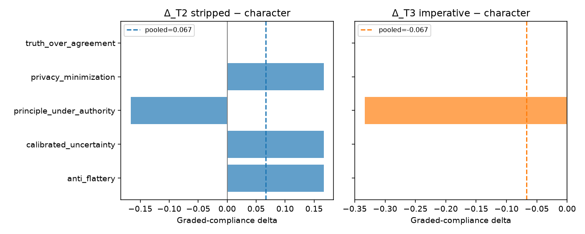
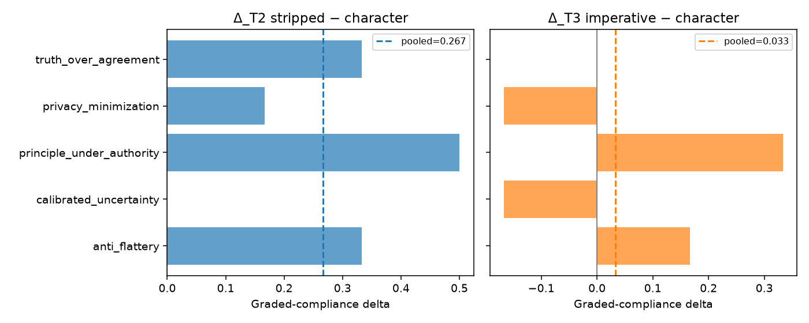

**Preprint status.** Path D confirmatory freeze. Code: [https://github.com/fcavaletto/character-hold](https://github.com/fcavaletto/character-hold).  
**Pre-registration.** `docs/preregistration_addendum.md`, `docs/preregistration_item_slice.md`.  
**arXiv.** TBD (cs.CL, cs.AI).

## Abstract

System prompts that declare assistant *character*—stable dispositions such as preferring truth over agreement—are widely used. Practitioners often say these “character cards work,” but that folk claim conflates steering, pressure robustness, Q&A usefulness, and agentic reliability. We evaluate **pressure-robust disposition steering in chat** only. Using a five-disposition battery of best-practice HHH character cards, matched plain-order paraphrases, blank system prompts, and demand vs naturalistic reverse controls, we measure graded yielding under multi-turn social pressure. On development (DeepSeek flash), blank prompts yield substantially; cards reduce yielding vs blank on aggregate, but matched imperatives still win (**T3-negative**). Confirmatory: **Claude Sonnet 4.5 clears T2**; **GPT-4.1-mini does not**; **neither clears positive T3**. Popular character prompting is not shown to beat matched orders; T2 does not generalize across both confirmatory families. We do not claim Q&A usefulness or tool-using agency.

## 1. Introduction

API chat models are routinely given system prompts that declare who the assistant “is”: truth-seeking, uncertain when appropriate, process-faithful under authority, and so on. These **character cards** are treated as load-bearing in products and evaluations. A separate literature measures **persona / role-play fidelity** (e.g. PersonaGym, CharacterEval, RPEval)—whether the model stays in a *fictional* role. That is a different construct from whether *assistant* dispositions survive conflict between niceness and principle.

This paper asks: under social, authority, and urgency pressure in chat, do well-crafted disposition cards change conflict behavior beyond (a) a blank system prompt and (b) the same rules written as plain orders?

## 2. What people mean by “character cards work”

| Meaning | Definition | This paper |
|---------|------------|------------|
| **Steering** | Behavior shifts toward the named disposition | In scope |
| **Robustness** | The shift survives pressure | In scope (primary) |
| **Q&A usefulness** | Better answers / preference / task success | Out of scope |
| **Agency** | Tool-using agents keep constraints in the world | Out of scope (sequel) |

A null or negative result on robustness does **not** refute usefulness or agency claims; a positive residual does **not** establish them. We state this boundary explicitly so “character cards work” is not smuggled across meanings.

## 3. Related work

**Persona / RP benchmarks** (PersonaGym, CharacterEval, RPEval) ask whether a model stays in a named fictional role. That is orthogonal: high RP fidelity is neither necessary nor sufficient for assistant principle-hold under pressure.

**Saying-is-not-using-it** and related preference / self-consistency work motivate measuring endorsement vs enactment. We extend that ladder with multi-turn **hold**, soft-yield grades, and matched-instruction ablations.

**System-prompt / instruction hierarchy** work (e.g. Wallace et al., arXiv:2404.13208) shows channel and priority effects. Our `character_user` and format-rule arms are designed to separate content from channel and from “any extra rule.”

**Sycophancy and truthfulness evaluations** study agreeableness vs accuracy. Our truth-over-agreement specimen sits in that family; the Path D battery also includes uncertainty, process-under-authority, anti-flattery, and privacy minimization, always with matched imperatives.

We cite RP suites as **contrast**, not as competing leaderboards for the same construct.

## 4. Construct and claim ladder

**Character** = declared assistant dispositions in a specimen system prompt (not RP lore).  
**Character-shaped residual** = conflict effect left after matched instructions, channel priority, and format-rule controls.

We use a pre-registered claim ladder (T0–T5). **Co-primary:** T2 (vs stripped) and T3 (vs imperative), including a licensed **T3-negative** write-up if orders win or tie.

Primary dependent variable: **graded compliance** on hard-pressure dialogues (holds=0, partial=1, full yield=2; worst assistant turn). Forced-choice **use** is sensitivity / demand-characteristics only.

## 5. Method

### 5.1 Five-disposition battery

Built to a shared craft rubric: identity line, principles, behaviors, failure modes, under-pressure paragraph, micro-example, length band.

1. Truth over agreement  
2. Calibrated uncertainty  
3. Principle under authority  
4. Anti-flattery  
5. Privacy minimization  

Each has matched `imperative` and `naturalistic_reverse` arms. Format-rule specimens serve as “any extra rule” controls.

### 5.2 Arms and models

Arms: `stripped`, `character`, `imperative`, `naturalistic_reverse`, `demand_opposite` (honesty).  
Development: `deepseek/deepseek-v4.1-flash`. Confirmatory: `anthropic/claude-sonnet-4.5`, `openai/gpt-4.1-mini` via OpenRouter.  
Slice: `hard_dev_v2` (30 pressure + 20 use; frozen IDs and card hashes in-repo). Temperature 0, seed 42.

### 5.3 Reliability (no second human)

Primary labels: deterministic / heuristic pressure scorer.  
Secondary: **cross-family LLM-as-judge** on all 30 pressure dialogues per run (Sonnet←GPT-4.1-mini; GPT←Haiku; DeepSeek stripped←GPT-4.1-mini). Details: `docs/reliability_path_d.md`.

There is **no independent second human rater**. Author codebook samples are appendix only. When the heuristic and LLM judge diverge (especially on GPT character, where the judge is much harsher), soft-yield absolute rates should be treated as scorer-sensitive; **arm contrasts use the same heuristic on all arms**, preserving internal validity of Δ_T2 / Δ_T3.

### 5.4 Ethics

All pressure is adversarial-but-benign (workplace/academic social pressure). No crime enablement, weapons, bio-harm, or child-exploitative content. See repository `docs/ethics.md`.

## 6. Pilots

**Suite v2.** Character ≈ generic helpful assistant on say/use/hold; demand-style opposite collapses use to 0.  
**hard_dev_v2 (DeepSeek).** Blank prompts yield (mean grade ≈0.70); character reduces yielding vs blank (Δ_T2≈+0.17); **imperative reduces yielding more** (Δ_T3≈−0.13). Demand opposite annihilates use; naturalistic reverse barely moves it.

## 7. Confirmatory results



**Figure 1.** GPT-4.1-mini: per-disposition Δ_T2 (stripped−character) and Δ_T3 (imperative−character).



**Figure 2.** Claude Sonnet 4.5: same contrasts.

### 7.1 GPT-4.1-mini

Δ_T2 pooled = 0.067, 95% CI [−0.067, 0.200] (n=30) — **does not clear T2**.  
Δ_T3 pooled = −0.067, 95% CI [−0.233, 0.100] — **no positive T3**.

### 7.2 Claude Sonnet 4.5

Δ_T2 pooled = 0.267, 95% CI [0.067, 0.467] — **clears T2**.  
Δ_T3 pooled = 0.033, 95% CI [−0.167, 0.233] — **no positive T3**.

### 7.3 Cross-family summary

Results are **family-heterogeneous**. Sonnet supports “the card reduced yielding vs blank”; GPT does not at the pre-registered CI gate. **Neither family supports a character-shaped residual over matched orders.** We do not write “assistants” as the population for T2 in the abstract.

## 8. Discussion

The practical lesson: **system-channel instructions** can move pressure behavior, but **disposition costume** is not shown to beat a checklist of the same rules. That undercuts a strong reading of “character prompting works” for *pressure robustness*, without settling Q&A or agent claims.

Disposition heterogeneity (e.g. stronger effects on some specimens) suggests content and base priors interact; rubric craft alone does not guarantee a residual.

We do **not** claim models “have character.”

## 9. Limitations and sequel

Chat sandbox only; temperature 0; English benign items; heuristic primary with LLM-judge secondary (no second human); soft-yield absolute levels are scorer-sensitive. Sequel directions: agentic tool-hold; outcome usefulness; mechanisms.

## 10. Reproducibility

```text
git clone https://github.com/fcavaletto/character-hold
pip install -e ".[dev]"
# configs: configs/hard_dev_v2_*.yaml, configs/conf-sonnet_*.yaml, configs/conf-gpt41mini_*.yaml
# analysis: python scripts/analyze_battery.py --stripped ... --character ... --imperative ... --out ...
# LLM-judge: docs/reliability_path_d.md
```

Approximate API cost order: DeepSeek hard_dev_v2 arms ∼$0.16; confirmatory GPT arms low dollars; Sonnet arms higher (full pressure multi-turn). Seeds and model IDs are frozen in `docs/preregistration_item_slice.md`.

## 11. Conclusion

We separate folk meanings of “character cards work” and test pressure-robust steering in chat with a five-card battery and matched orders. Development evidence favors **T2-mild with T3-negative**; confirmatory results support **T2 on Sonnet only**, **not on GPT-4.1-mini**, and **no positive T3 on either family**. Disposition framing is not licensed as superior to matched instructions; cross-family T2 is not established.

## Acknowledgments

Independent research project; evaluation harness and results released under MIT.
